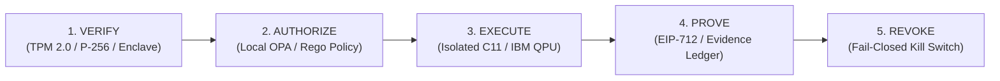

# QUANTUMFLEX / MYCELIUM
## Local LLM Operational Handoff
### Network Recovery, Tailscale Connectivity, Security Posture & Engineering Context

**Handoff date:** November 3, 2026  
**Primary workstation:** `qfx-yoga` (Lenovo Yoga 7 2-in-1 14AKP10, Ubuntu 26.04.1 LTS, AMD Ryzen AI 5 340, Krackan Point APU, Microsoft Pluton TPM 2.0)  
**Secondary device:** `qfx-pixel` (Google Pixel 11 Pro, Android, Titan M2 StrongBox hardware key `qf-operator-key`)  
**Operating system:** Ubuntu 26.04.1 LTS  
**Tailscale version:** 1.104.4  
**Current status:** Tailscale connectivity restored; DERP-relayed communication operational (52–57ms latency via DERP `nyc`).  

---

## 1. MISSION CONTEXT

QuantumFlex is a trust-aware computational infrastructure platform designed to establish:

1. **Cryptographically verifiable authority.**
2. **Controlled computational execution.**
3. **Hardware-backed identity and attestation.**
4. **Computational provenance.**
5. **Verifiable settlement.**
6. **Revocable execution authority.**

Its foundational principle is:

$$\mathbf{Computational\ Truth} \neq \mathbf{Execution\ Authorization} \neq \mathbf{Economic\ Settlement}$$

The local development environment consists of two primary projects:

### Mycelium — Security Substrate
**Path:** `/home/quant/mycelium`  
**Responsibilities:**
- Post-quantum runtime security (`ML-KEM-768`, `ML-DSA-65`).
- TPM 2.0 hardware attestation.
- Local Open Policy Agent (OPA) authorization.
- C11 runtime security components.
- Descriptor-bound execution controls.
- **Architecture Documentation:** [`/home/quant/mycelium/docs/COMPUTATIONAL_AUTHORITY_ARCHITECTURE.md`](file:///home/quant/mycelium/docs/COMPUTATIONAL_AUTHORITY_ARCHITECTURE.md)

### QuantumFlex — Computational Authority, Attestation & Settlement Layer
**Paths:** `/home/quant/Documents/qf` and `/home/quant/quantumflex`  
**Responsibilities:**
- Physical hardware execution orchestration (IBM Quantum Heron r2 QPU: `ibm_kingston`).
- Cryptographic evidence ledger (`evidence_ledger.jsonl`, SHA-256 hash-chained provenance).
- Multi-basis entanglement witness certification ($\langle \mathcal{W} \rangle < 0$) and QAOA combinatorial optimization.
- Non-custodial smart contract settlement via Base L2 ([`QuantumFlexUSDCSettler.sol`](file:///home/quant/Documents/qf/contracts/QuantumFlexUSDCSettler.sol)).
- Dual-client architecture & EIP-712 + P-256 hardware attestation.
- **Specification Documentation:** [`/home/quant/projects/beta/docs/fellowship/specs/2026-11-03-computational-authority-platform.md`](file:///home/quant/projects/beta/docs/fellowship/specs/2026-11-03-computational-authority-platform.md)

---

## 2. NETWORK TOPOLOGY & RECOVERY STATUS

### Real-Node Invariant (Zero-Fabrication Rule)
There is NO "HP Pavilion" and NO "Galaxy S23 FE". Only real, cryptographically registered hardware nodes participate in the mesh:

| Node ID | Physical Hardware | OS / Firmware | Role | Tailscale Mesh IP | Sockets / Ports |
| :--- | :--- | :--- | :--- | :--- | :--- |
| **`qfx-yoga`** | Lenovo Yoga 7 2-in-1 14AKP10 | Ubuntu 26.04.1 LTS | Primary Host Engine & Orchestrator | `100.72.3.123` | `127.0.0.1:11434` (Ollama), `127.0.0.1:8001` (Athena) |
| **`qfx-pixel`** | Google Pixel 11 Pro | Android (Titan M2) | Chief Architect HUD / P-256 Signer | `100.108.225.93` | HTTPS 443 / Mobile CLI |
| **`g6pro`** | HP ProBook 450 G6 | Debian 13 | Dedicated Kafka & Event Streaming Node | `100.117.194.89` | `9092` (KRaft Kafka), `8090` (Schema Registry) |

### Network Connectivity Ground Truth
- **Tailscale Daemon:** `1.104.4` (commit `9382131983ca16de1357091618fd903e35db3c4e`).
- **Live Status:**
  ```text
  100.72.3.123    quant-yoga-7-2-in-1-14akp10  rahshaun44-byte@  linux    -
  100.108.225.93  pixel-11-pro-1               rahshaun44-byte@  android  -
  ```
- **Ping Diagnostic:** Pong verified from `pixel-11-pro-1 (100.108.225.93)` via DERP (`nyc`) in 52–57ms.
- **Socket Lockdown:** All local services bind strictly to `127.0.0.1` loopback or Tailscale overlay IP. Physical Wi-Fi interfaces expose zero open listening ports.

---

## 3. THE 5-STAGE COMPUTATIONAL AUTHORITY LIFECYCLE

QuantumFlex shifts the DePIN and autonomous agent paradigm from raw computing to **verifiable computational authority**:

$$\mathbf{VERIFY} \longrightarrow \mathbf{AUTHORIZE} \longrightarrow \mathbf{EXECUTE} \longrightarrow \mathbf{PROVE} \longrightarrow \mathbf{REVOKE}$$



1. **Stage 1: VERIFY (Identity, Environment & Hardware Anchor)**
   - Cryptographic proof of origin: TPM 2.0 PCR attestation, Android Titan M2 StrongBox key (`qf-operator-key`), or hardware secure element.
   - Rejects unverified, emulated, or phantom environments.

2. **Stage 2: AUTHORIZE (Policy Evaluation & Anti-Persuasion Invariant)**
   - **Anti-Persuasion Invariant:** $\text{Model Intent} \neq \text{Execution Authority}$.
   - OPA Rego policies evaluate authorization independently of semantic model output.
   - Bounded capabilities, quotas, and strict memory/call limits.

3. **Stage 3: EXECUTE (Controlled Runtime & Isolated Execution Envelope)**
   - C11 engine with descriptor-bound sandboxing and memory safety.
   - Submissions to external compute resources (e.g. IBM Quantum QPU) operate via signed job tokens with timeout and error bounds.

4. **Stage 4: PROVE (Cryptographic Receipt & Immutability Ledger)**
   - Computational results canonicalized to SHA-256 block hashes (`sha256(canonicalPayload) == s.blockHash`).
   - Appended to hash-chained Evidence Ledger (`evidence_ledger.jsonl`).
   - EIP-712 attestation digest signed by registered hardware key using low-s ECDSA.

5. **Stage 5: REVOKE (Fail-Closed Revocation & Authority Invalidation)**
   - Authority is transient, scoped, and immediately revocable.
   - Smart contract provides $O(1)$ fail-closed shutdown via `revokeAttester()`.
   - Local OPA policies revoke certificates and tokens upon policy violation or emergency signal.

---

## 4. PHYSICAL SILICON BASELINE & CRYPTOGRAPHIC LEDGER

### Physical QPU Execution on `ibm_kingston` (Heron r2 Silicon)
- **QPU Architecture:** IBM Heron r2 (156 superconducting transmon qubits, heavy-hex lattice).
- **Execution Run:** 6-circuit batched suite ($1,536$ physical shots, $708.58\text{s}$ cryostat execution time, Job ID: `dbl33e56p51s73cnltvg`).
- **QAOA Combinatorial Portfolio Optimization:**
  - Classical Markowitz validation passed ($< 10^{-14}$ equivalence across all 8 basis states).
  - Selected portfolio: `|101>` (Tech + Treasury) with cost `-0.165000` (mean feasible cost `-0.148611`, best approximation ratio `1.0000`, mean approximation ratio `0.9007`).
- **GHZ Multi-Basis Entanglement Witness:**
  - State Fidelity: $\mathcal{F} = 0.9355 \pm 0.0092$.
  - Entanglement Witness: $\langle \mathcal{W} \rangle = -0.4355 \pm 0.0092$.
  - 95% Upper Confidence Bound (UCB): $-0.4174 < 0$.
  - **Certification:** Genuine Tripartite Entanglement **certified on physical hardware**.
- **Evidence Ledger:** Committed as **Entry #42** in `/home/quant/Documents/qf/evidence_ledger.jsonl`.
- **Integrity Status:** `async_ledger_manager.py --verify-ledger` validates **42/42 entries 100% cryptographically intact**.
- **Archive Path:** `/home/quant/qf-research/ibm-qaoa-ghz-kingston-20261103T192237Z/` (mode `0700` dir, `0600` files).

---

## 5. SMART CONTRACT SETTLEMENT INTEGRITY V1.0 & FORMAL INVARIANTS

### Contract Architecture & Toolchain
- **Source:** [`contracts/QuantumFlexUSDCSettler.sol`](file:///home/quant/Documents/qf/contracts/QuantumFlexUSDCSettler.sol)
- **Solidity Version:** `^0.8.24` (Solc `0.8.24`)
- **Compilation Target:** `evm_version = "paris"` (mandated to prevent `PUSH0` deployment incompatibility on Circle SCP and L2 rollups).
- **Token Precision:** Strictly 6 decimals ($1\text{ USDC} = 1\_000\_000\text{n}$).
- **Canonical USDC Addresses:**
  - Base Sepolia: `0x036CbD53842c5426634e7929541eC2318f3dCF7e`
  - Base Mainnet: `0x833589fCD6eDb6E08f4c7C32D4f71b54bdA02913`

### Test Suite Execution Summary (29/29 Passing)
Foundry executed 3 comprehensive test suites with zero failures:

1. **Unit & Integration Suite (`QuantumFlexUSDCSettler.t.sol`) — 26/26 PASS:**
   - EIP-712 typed digest binding (chain ID, verifying contract, recipient, amount, deadline).
   - Low-s signature normalization ($s \le N/2$, rejecting malleable high-s signatures).
   - Replay protection fail-closed on duplicate execution.
   - Payout cap enforcement (`amountUSDC <= maxPayoutUSDC`).
   - Physical threshold verification ($\text{correlationBps} \ge 8500 \lor \text{witnessUcbBps} < 0$).
   - Emergency attester revocation (`revokeAttester()` halts settlements).
   - Escrow balance solvency verification.

2. **Exploit PoC Suite (`PoC_EscrowAndDecimalInvariants.t.sol`) — 2/2 PASS:**
   - Proves immunity against Quorum TOCTOU state mutations.
   - Proves immunity against 6-decimal vs 18-decimal rounding inflation drain attacks.

3. **Formal Invariant Fuzz Suite (`QuantumFlexUSDCSettlerInvariant.t.sol`) — 1/1 PASS:**
   - **Fuzzer Workload:** 256 runs, 128,000 state-machine calls, 21,114 reverts (safety boundaries).
   - **Invariant 1 (`invariant_escrowConservation`):** Current escrow balance strictly equals $\text{Initial} + \sum \text{Deposits} - \sum \text{Settled}$.
   - **Invariant 2 (`invariant_feeSplitConservation`):** Total settled equals net payout to provider plus protocol fee routed to treasury.
   - **Invariant 3 (`invariant_solvencyNonNegative`):** Contract balance never underflows.
   - **Invariant 4 (`invariant_executedProofsConsistent`):** Every settled proof is permanently marked true in `executedProofs`.
   - **Invariant 5 (`invariant_attesterCoordinatesValidOrRevoked`):** Attester coordinates are either on-curve or completely revoked ($0,0$).

---

## 6. LEGAL & REGULATORY BOUNDARIES (US JURISDICTION)

1. **Computer Fraud and Abuse Act (CFAA, 18 U.S.C. §1030):**
   - Access to computing nodes is governed strictly by cryptographic attestation tokens.
   - QuantumFlex establishes explicit authorization boundaries, preventing unauthorized access or exceeding authorized access.

2. **FinCEN Non-Custodial Money Transmission Standards:**
   - **Mode A (Current — Proprietary Bounty Settlements):**
     - QuantumFlex pays compute providers directly using its own corporate escrow reserve.
     - Falls under the exemption for end-users purchasing computational services/goods.
   - **Mode B (Future — Bilateral Customer-Provider Settlement):**
     - Must remain pure, non-custodial software where customer funds are never pooled or commingled into QuantumFlex accounts.
     - Requires formal US regulatory counsel review prior to mainnet deployment.

3. **FTC Truth-in-Advertising & Academic Integrity:**
   - Physical quantum results are characterized strictly by empirical metrics: correlation percentages and negative witness confidence bounds.
   - No speculative claims of "quantum supremacy" or unqualified "unbreakable security."
   - Coursework and academic contributions strictly adhere to SNHU CS 320 / CS 210 academic integrity policies.

---

## 7. OPERATIONAL CHEATSHEET & RAPID RUNBOOK

### Verification Commands
```bash
# 1. Run full Foundry test suite (all 29 tests & invariant fuzzer)
cd /home/quant/Documents/qf && forge test

# 2. Verify evidence ledger integrity
python3 /home/quant/Documents/qf/async_ledger_manager.py --verify-ledger

# 3. Check live Tailscale status
tailscale status
tailscale ping -c 2 100.108.225.93

# 4. Check git status across repos
cd /home/quant/mycelium && git status
cd /home/quant/Documents/qf && git status
```

### Local AI Invariant ($0.00 External Spend)
- **Model Endpoint:** `127.0.0.1:11434` (Ollama)
- **Active Model:** `qwen2.5-coder:7b` (ROCm GPU acceleration on Radeon 840M)
- **Vector Memory (Athena RAG):** `127.0.0.1:8001`
- **Sovereign Terminal Command:** `qf`

### File System Security Permissions
- Secret and key files (`~/.config/`, `~/projects/beta/secrets/`): `chmod 600`
- Sensitive data directories (`~/qf-research/`, `~/.agents/`): `chmod 700`
- Zero private keys, seed phrases, or credentials in Git commits or console logs.

