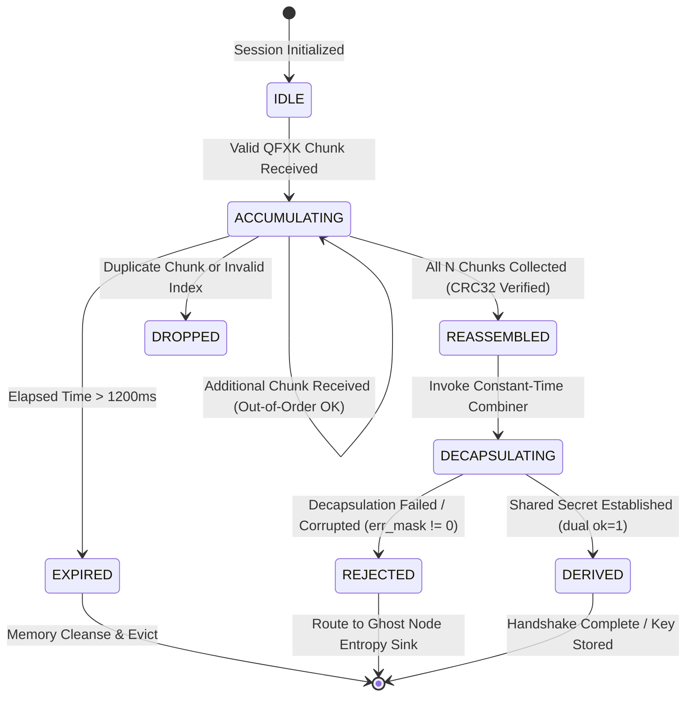

# QFXK Binary Wire Framing Protocol Specification (v1.0)

**Status**: Release Specification  
**Protocol Identifier**: `0x5146584B` (`"QFXK"`)  
**Associated Primitives**: FrodoKEM-976-AES + X25519 (CFRG Hybrid KEM)  
**Carrier Requirement**: TLS 1.3 / mTLS (Port 9443) on Tailscale WireGuard Mesh  

---

## 1. Motivation & Design Goals

Post-quantum cryptographic primitives introduce significant wire payload expansions. A FrodoKEM-976 public key requires 15,632 bytes and its ciphertext requires 15,744 bytes. Over standard Ethernet links (MTU = 1500 bytes), these cryptographic objects exceed single-packet limits and require deterministic fragmentation and reassembly.

The **QFXK** framing protocol provides:
1. **Bounded MTU Chunking**: Splits large cryptographic keys and ciphertexts into discrete frames $\le 1450$ bytes to prevent IP fragmentation attacks.
2. **Reassembly Integrity**: Verifies each chunk with an IEEE 802.3 32-bit Cyclic Redundancy Check (CRC32).
3. **Bounded Gatekeeper State**: Caps concurrent reassembly sessions to 64 and enforces a 1200ms dead-reckoning window to eliminate state-exhaustion denial of service.
4. **Zero Timing Leakage**: Guarantees constant-time frame processing and fail-closed rejection routing to the Ghost Node entropy sink.

---

## 2. Binary Frame Header Layout

Every QFXK wire frame begins with a fixed 16-byte binary header, followed immediately by the chunk payload. All multi-byte numeric fields are encoded in **network byte order (Big-Endian)**.

```
 0                   1                   2                   3
 0 1 2 3 4 5 6 7 8 9 0 1 2 3 4 5 6 7 8 9 0 1 2 3 4 5 6 7 8 9 0 1
+-+-+-+-+-+-+-+-+-+-+-+-+-+-+-+-+-+-+-+-+-+-+-+-+-+-+-+-+-+-+-+-+
|                       Magic: "QFXK" (0x5146584B)              |
+-+-+-+-+-+-+-+-+-+-+-+-+-+-+-+-+-+-+-+-+-+-+-+-+-+-+-+-+-+-+-+-+
|   MsgType     |     Flags     |          Sequence ID          |
+-+-+-+-+-+-+-+-+-+-+-+-+-+-+-+-+-+-+-+-+-+-+-+-+-+-+-+-+-+-+-+-+
| (Seq ID cont) | Total Chunks  |  Chunk Index  |  Chunk Length |
+-+-+-+-+-+-+-+-+-+-+-+-+-+-+-+-+-+-+-+-+-+-+-+-+-+-+-+-+-+-+-+-+
| (Len cont)    |                   CRC-32                      |
+-+-+-+-+-+-+-+-+-+-+-+-+-+-+-+-+-+-+-+-+-+-+-+-+-+-+-+-+-+-+-+-+
| (CRC cont)    | Payload Data (0 to 1450 bytes) ...            |
+-+-+-+-+-+-+-+-+-+-+-+-+-+-+-+-+-+-+-+-+-+-+-+-+-+-+-+-+-+-+-+-+
```

### Detailed Field Definitions

| Offset | Field | Type | Description / Valid Values |
| :--- | :--- | :--- | :--- |
| `0..3` | **Magic** | `uint32_t` | Constant magic bytes: `0x5146584B` (ASCII `"QFXK"`). Any mismatch results in immediate frame drop. |
| `4` | **MsgType** | `uint8_t` | Message type identifier:<br>• `0x01` (`MSG_INIT`): Control line encapsulation.<br>• `0x02` (`MSG_KEM_PK`): Ephemeral Public Key.<br>• `0x03` (`MSG_KEM_CT`): Ephemeral Ciphertext.<br>• `0x04` (`MSG_KEM_ACK`): Handshake Acknowledgement.<br>• `0x7F` (`MSG_KEM_REJECT`): Fail-closed rejection signal. |
| `5` | **Flags** | `uint8_t` | Bitmask control flags:<br>• `0x01` (`FLAG_FINAL`): Final chunk of the message.<br>• `0x02` (`FLAG_RETRANSMIT`): Retransmitted chunk.<br>• `0x04` (`FLAG_ENCRYPTED`): Chunk payload is pre-encrypted. |
| `6..7` | **Chunk Index / Seq ID** | `uint16_t` | Zero-indexed position of this chunk ($0 \le i < N \le 64$). |
| `8..9` | **Total Chunks** | `uint16_t` | Total chunks comprising this message ($1 \le N \le 64$). |
| `10..11`| **Chunk Length** | `uint16_t` | Length in bytes of the following chunk payload ($1 \le L \le 1400$). |
| `12..15`| **CRC-32** | `uint32_t` | IEEE 802.3 standard CRC32 checksum computed over the chunk payload bytes. |

---

## 3. Protocol State Machine

The Gatekeeper reassembly state machine processes frames per session ID:



---

## 4. Resource Bounds & Anti-Exhaustion Rules

1. **Reassembly Table Capacity**:
   - Maximum concurrent sessions: **64**.
   - Maximum memory footprint: $64 \times 16\,\text{KB} \approx 1.024\,\text{MB}$.
   - **Eviction Policy**: When a new session arrives and the table holds 64 sessions:
     1. Expired sessions ($> 1200\,\text{ms}$) are swept and freed via `OPENSSL_cleanse`.
     2. If still at capacity, the oldest session with the fewest received chunks is evicted.
2. **Chunk Limits**:
   - `total_chunks` must satisfy $1 \le \text{total\_chunks} \le 64$.
   - `chunk_len` must satisfy $1 \le \text{chunk\_len} \le 1450$.
   - Any frame violating these bounds is rejected with `ERR_INVALID_CHUNK_BOUNDS`.
3. **Sequence Number Monotonicity & Rollover**:
   - Sequence IDs must increment monotonically.
   - If `seq_id >= 0xFFFFFFFE` ($2^{32}-2$), the Gatekeeper closes the session and requires client re-initialization. **Silent sequence wraparound to zero is strictly forbidden**.
4. **Framing Integrity vs Cryptographic Authenticity**:
   - The 32-bit CRC in the header provides **link-level transport integrity** to detect packet fragmentation damage.
   - It is **not** a cryptographic MAC. True payload authentication and tamper-resistance are provided by wrapping QFXK inside an **mTLS session** (Port 9443) or via the HKDF-derived application AEAD cipher.

---

## 5. Error Code Registry

| Error Code | Name | Numerical | Description |
| :--- | :--- | :--- | :--- |
| `0x00` | `OK` | `0` | Nominal execution. |
| `0x01` | `ERR_MAGIC` | `1` | Frame does not begin with `"QFXK"` (`0x5146584B`). |
| `0x02` | `ERR_LENGTH` | `2` | Frame payload truncated or smaller than header specifies. |
| `0x03` | `ERR_CHUNK_BOUNDS` | `3` | `total_chunks > 64`, `chunk_idx >= total_chunks`, or `chunk_len > 1450`. |
| `0x04` | `ERR_CRC_MISMATCH` | `4` | Computed IEEE 802.3 CRC32 does not match header checksum. |
| `0x05` | `ERR_TIMEOUT` | `5` | Reassembly exceeded 1200ms deadline. |
| `0x06` | `ERR_TABLE_FULL` | `6` | Reassembly table reached 64 sessions and eviction was forced. |
| `0x07` | `ERR_SEQ_EXHAUSTED`| `7` | Sequence ID reached limit ($2^{32}-1$); renegotiation required. |
| `0x08` | `ERR_DECAP_FAILED` | `8` | Constant-time decapsulation failed (RFC 7748 low-order or Frodo noise perturbation). |
