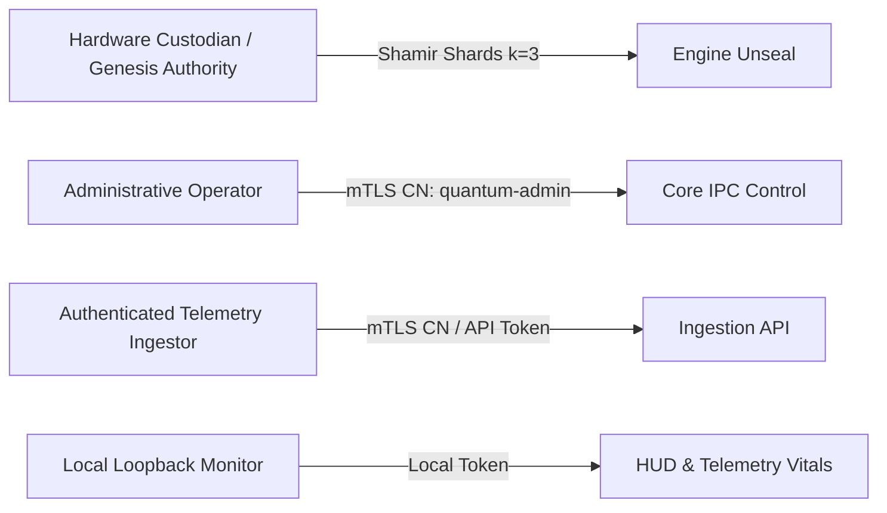

# QuantumFlex Security Target and Measurable Promises Specification

**Document Version:** 1.0.0  
**Target of Evaluation (TOE):** QuantumFlex Mycelium Enclave (Core C++ Engine v2.5, PQC Immune Daemon, Sentinel Gatekeeper, Amara/Athena API Strata)  
**Standard Baseline:** NIST SP 800-53 Rev 5, NIST FIPS 203 (ML-KEM), OMB Memorandum M-26-15  
**Evaluation Date:** September 2026  

---

## 1. Executive Summary & Objective

This document establishes the formal, measurable security target for the QuantumFlex Mycelium platform. It eliminates marketing and heuristic abstractions in favor of mathematically bounded, verifiable security controls. It specifies:
1. Exact assets under cryptographic and operational protection.
2. Distinct authorized actor personas and authentication credentials.
3. Attacker capabilities, exposure surfaces, and explicit trust boundaries.
4. Deterministic failure behavior (fail-closed and disposable quarantine containment).
5. Explicit operational limits, non-claims, and accreditation distinctions.

---

## 2. Protected Assets

The QuantumFlex platform provides confidentiality, integrity, availability, and non-repudiation guarantees for the following designated assets:

| Asset ID | Asset Name | Description & Storage Form | Security Objective |
| :--- | :--- | :--- | :--- |
| **AST-01** | **Telemetry Evidence Ledger** | Append-only Merkle-linked audit records stored in `ledger.dat` and PostgreSQL `quantum_telemetry_channel`. | **Integrity & Non-Repudiation**: Historical state roots cannot be rewritten or modified without detection. |
| **AST-02** | **Ephemeral KEM Secrets** | Ephemeral shared secrets derived during ML-KEM-768 key encapsulation. | **Confidentiality & Forward Secrecy**: Volatile memory zeroization (`OPENSSL_cleanse`) immediately after key derivation; never exposed over wire or disk. |
| **AST-03** | **Dynamic Reconstruction Salt** | Dynamic entropy recovered via Shamir Secret Sharing ($k=3, n=5$) in GF(256). | **Confidentiality**: Exists strictly in volatile memory of unsealed engine; zeroized upon service lock or termination. |
| **AST-04** | **Vault Shards** | Individual Shamir polynomial points ($x_i, y_i$). Shards 1–2 reside on host (`chmod 0600`); Shards 3–5 reside on external USB media or cold backup. | **Confidentiality & Access Control**: Threshold $\ge 3$ required to unseal; sub-threshold subsets ($<3$) yield zero information about the secret. |
| **AST-05** | **Node Identity Private Keys** | Ed25519 / ML-DSA-65 private keys used for node attestation and telemetry signing. | **Confidentiality**: Protected by filesystem ACLs (`chmod 0600`) and unprivileged runtime UID. |
| **AST-06** | **Quarantine Airlock Staging** | Inbound unverified files and suspicious payloads staged in tmpfs (`/dev/shm/qflex_airlock`). | **Isolation**: Ephemeral volatile containment; isolated Podman sandbox analysis before promotion or permanent destruction. |

---

## 3. Authorized Actors and Personas

Access to TOE interfaces is restricted to four distinct actor identities:



1. **Genesis Authority / Hardware Custodian (ACT-01)**:
   - **Credential**: Physical custody of $\ge 3$ Shamir shard files (`shard_*.txt`).
   - **Authority**: Authorizes initial genesis envelope creation (`INIT|`) and runtime node unsealing (`UNLOCK|`).
2. **Administrative Operator (ACT-02)**:
   - **Credential**: Mutual TLS (mTLS) client certificate signed by the Mycelium Root CA with `CommonName = quantum-admin` or `operator`.
   - **Authority**: Authorized to issue `SET_HARVESTER_KEY|`, peer enrollment, and engine state management.
3. **Authenticated Telemetry Ingestor (ACT-03)**:
   - **Credential**: mTLS client certificate signed by Mycelium Root CA or HTTP Bearer token matching configured API keys.
   - **Authority**: Authorized to submit telemetry frames (`TELEMETRY|`) and staged file uploads into the airlock. Cannot alter keys or engine state.
4. **Local Loopback Monitor (ACT-04)**:
   - **Credential**: Unprivileged local process communicating over loopback (`127.0.0.1`).
   - **Authority**: Read-only status checks (`python3 qflex.py status`, `qflex.py pqc`).

---

## 4. Attacker Capabilities & Threat Model

The platform is defended against five threat actor profiles:

```
[Threat Profiles]
 ├── ADV-01: Local Unprivileged Host Attacker (Non-root user)
 ├── ADV-02: Adjacent Network Observer / Ingress Attacker (LAN / WAN)
 ├── ADV-03: Compromised Telemetry Client / Malicious Ingestor
 ├── ADV-04: Sub-Threshold Physical Media Adversary (<3 Shards)
 └── ADV-05: Post-Quantum Adversary (Harvest-Now-Decrypt-Later with CRQC)
```

### Detailed Threat Boundaries:

1. **ADV-01 (Local Unprivileged Host Attacker)**:
   - *Capabilities*: Can execute arbitrary code under a separate unprivileged UID or unprivileged user account.
   - *Boundary Guarantee*: Cannot read host shards or mTLS keys (`chmod 0600`), cannot read tmpfs airlock without UID match, cannot mutate systemd units.
2. **ADV-02 (Adjacent Network Attacker)**:
   - *Capabilities*: Can observe and inject packets on the external network interfaces (Ethernet, Wi-Fi).
   - *Boundary Guarantee*: All TOE application ports are strictly bound to loopback `127.0.0.1`. Ingress from external interfaces is dropped at the IP stack before reaching application sockets.
3. **ADV-03 (Compromised Client / Malicious Ingestor)**:
   - *Capabilities*: Possesses valid or invalid telemetry credentials; attempts to send malformed wire frames, SQL injections, shell command payloads, or unauthorized admin commands (`SET_HARVESTER_KEY`).
   - *Boundary Guarantee*: Command allowlisting in Dashboard, parameter-binding in PostgreSQL, CN validation in C++ IPC, and routing of unverified payloads into disposable Alpine containers in tmpfs airlock.
4. **ADV-04 (Sub-Threshold Physical Adversary)**:
   - *Capabilities*: Gains physical possession of the host machine (access to host shards 1 and 2) without the external USB vault (shards 3, 4, 5).
   - *Boundary Guarantee*: Information-theoretic security of Shamir Secret Sharing in GF(256) guarantees that 2 shards reveal zero information regarding the unsealing salt.
5. **ADV-05 (Cryptographically Relevant Quantum Computer / CRQC)**:
   - *Capabilities*: Harvests network traffic today with the capability to run Shor's algorithm on elliptic curves and RSA in the future.
   - *Boundary Guarantee*: Core encapsulation implements NIST FIPS 203 (ML-KEM-768), maintaining 192 bits of post-quantum security against quantum adversaries.

---

## 5. Measurable Security Promises

| ID | Promise Statement | Enforcement Mechanism | Verification Method |
| :--- | :--- | :--- | :--- |
| **PRM-01** | **Strict FIPS 203 Post-Quantum Enforcement** | Under `fips_strict` profile, any compromise of ML-KEM-768 triggers an immediate fallback to `NONE`, halting operations rather than stepping down to ML-KEM-512 or FrodoKEM. | `pqc-immune-daemon` Rego/Wasm policy; `pytest tests/test_strict_pqc.py`. |
| **PRM-02** | **Zeroization of Ephemeral Key Material** | All ephemeral shared secrets and Shamir reconstruction salts are purged using `OPENSSL_cleanse()` immediately after use or upon lock. | C++ `OPENSSL_cleanse`; `tools/test_zeroization.cpp`. |
| **PRM-03** | **Fail-Closed Engine Lock** | Upon service startup or restart, the engine initializes exclusively into the `LOCKED` state, rejecting all telemetry and mutations with `ERR|NODE_LOCKED`. | `LocalNode::load_state()`; mTLS IPC test with `qf_ipc_client.py`. |
| **PRM-04** | **Mutual Authentication & CN Authorization** | The engine socket on port 9444 strictly enforces TLS 1.3 mTLS; administrative mutation commands require CN allowlisting (`quantum-admin`, `operator`). | `IpcServer::handle_active_telemetry()`; mTLS unauthorized CN tests. |
| **PRM-05** | **Disposable Airlock Containment** | Inbound suspicious files are staged in unique UUID subdirectories under tmpfs (`/dev/shm/qflex_airlock/<uuid>`), evaluated in disposable unprivileged containers, and wiped on exit. | `sentinel/quarantine_chamber.py`; `run_sentinel.py`; tmpfs boundary test. |
| **PRM-06** | **Append-Only Ledger Immutability** | Database roles for ingestion (`quantum_sentinel`) have strictly `INSERT` and `SELECT` permissions, prohibiting `UPDATE`, `DELETE`, or `DROP`. | PostgreSQL schema ACLs; `scripts/audit_deployed_permissions.sh`. |

---

## 6. Deterministic Failure Behaviors

When unexpected conditions, attacks, or faults occur, the TOE adheres to the following deterministic failure matrix:

```
[System Failure Conditions & Responses]
 ├── TLS Handshake Stall (> 5s)      ──► Socket terminated by SO_RCVTIMEO
 ├── Non-TLS Plaintext on Port 9444  ──► OpenSSL SSL_accept error, socket closed
 ├── Unauthorized CN on Mutation     ──► ERR|UNAUTHORIZED_HARVESTER_MUTATION, EWMA drop
 ├── Malformed Wire Framing          ──► Buffer cleansed, EWMA drop, socket closed
 ├── Corrupted / Tampered ledger.dat ──► Enters QUARANTINED, fails to start
 ├── OPA Daemon Unreachable          ──► Invariant Gate fails closed (DENY)
 └── Engine Process Terminated       ──► Restarts into LOCKED state (Zero RAM salt)
```

---

## 7. Explicit Exclusions and Assumptions

To prevent overclaiming compliance, the following boundaries are formally declared:

1. **OpenSSL 3.5.8 Default Provider vs CMVP FIPS 140-3 Validation**:
   - The platform natively executes NIST FIPS 203 ML-KEM-768 algorithms using OpenSSL 3.5.8.
   - This native execution **does not constitute a FIPS 140-3 validated cryptographic module**. FIPS 140-3 requires a CMVP-validated cryptographic module (`fips.so`) loaded under approved operating conditions.
2. **Host Root & Kernel Trust**:
   - If an attacker gains `root` privileges or kernel execution on the host OS, software-level protections (process memory isolation, file permissions) are compromised. The software does not claim defense against a compromised host kernel.
3. **Biological Metaphor Scope**:
   - Architectural terminology (such as "biological strata", "mycelium", "membrane health", "shock absorber") describes software layers and design patterns. These terms imply no biological or physical material properties.
